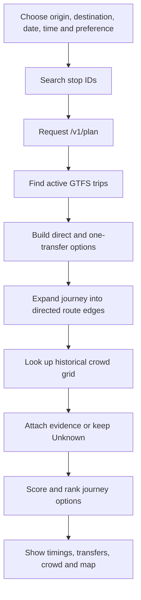
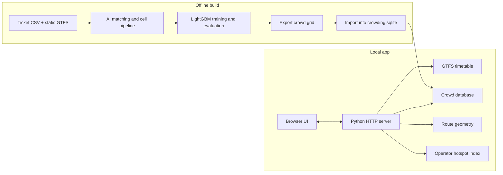

# Delhi Bus Atlas — AI-integrated crowd-aware bus journey planner

Delhi Bus Atlas is an offline-first journey planner for Delhi buses. It combines DTC/DIMTS static GTFS schedules, historical ticket-derived crowd estimates, route geometry and a local browser interface to help compare scheduled bus journeys by travel time and historical crowd conditions. It is made to ease the journey of commuters, travellers.

> **Important:** Crowd estimates represent historical ticketed passengers per scheduled bus traversal of a route stretch. They are not live passenger counts, vehicle occupancy or seat availability. Unsupported estimates are shown as **Unknown**, not as Low.

## At a glance

- **Journey planning:** direct and one-transfer scheduled bus journeys.
- **Crowd-aware ranking:** adjust the balance between faster arrival and lower historical crowd.
- **Evidence transparency:** view supporting ticket crossings, contributing dates and coverage.
- **Offline map:** display GTFS route geometry and stop connections without a map API.
- **Operator view:** inspect historically higher-load route stretches by day type and half-hour.
- **Bilingual interface:** English and Hindi.
- **Local journey assistant:** recognizes a limited set of journey-related question types and grounds answers in planner results.

## Contents

- [Features](#features)
- [How a journey is planned](#how-a-journey-is-planned)
- [System architecture](#system-architecture)
- [Technology stack](#technology-stack)
- [Project structure](#project-structure)
- [Getting started](#getting-started)
- [AI crowd-estimation pipeline](#ai-crowd-estimation-pipeline)
- [Model results and evidence policy](#model-results-and-evidence-policy)
- [Verification](#verification)
- [HTTP API](#http-api)
- [Limitations and responsible interpretation](#limitations-and-responsible-interpretation)
- [Data sources and privacy](#data-sources-and-privacy)
- [Detailed documentation](#detailed-documentation)

## Features

### For a passenger
- Search origin and destination stops.
- Compare direct and one-transfer options using scheduled GTFS trips.
- Adjust the comfort preference to trade off arrival time and crowd penalty.
- Inspect route legs, departure/arrival times, transfer wait, crowd bands and evidence.
- View route geometry on the offline map.
- Compare the current journey with selected later departures when the advice conditions are met.
- Use the interface in English or Hindi.

### For an operator / analyst
- View high-load stretches for a selected day type and half-hour bin.
- Inspect the historical evidence attached to supported estimates.
- Distinguish supported estimates from cells that remain Unknown.

### What the crowd labels mean
The model predicts ticketed passengers crossing a directed stop-to-stop stretch per scheduled bus traversal. Supported predictions are grouped into relative bands: **Low, Medium, High and Very High**. The bands are not vehicle-capacity thresholds. A cell needs at least 10 ticket crossings across at least 3 distinct dates before its rate is published. Other scheduled cells remain **Unknown**.

## How a journey is planned

1. The user selects origin, destination, date, departure time and comfort preference.
2. The browser searches stop IDs and requests journey options from the local Python server.
3. The routing engine checks active GTFS service patterns and scheduled departures.
4. It builds direct and one-transfer candidates. A transfer must use the same GTFS stop ID and allow 2–45 minutes to connect.
5. Each ridden leg is expanded into directed stop-to-stop edges.
6. The planner looks up crowd evidence using route, from-stop, to-stop, day type and half-hour bin.
7. Journey alternatives are scored and returned with travel times, crowd bands, coverage and supporting evidence.
8. The browser renders the alternatives and available offline route geometry.

The first-departure search window is 60 minutes. The planner scores a bounded set of alternatives; it is not a live vehicle-routing or traffic prediction system.

### Journey flow



## System architecture

The project separates the expensive offline data/model build from normal app usage. The LightGBM model is not run for every journey request: predictions are exported to a grid and imported into SQLite for fast local lookup.



### Technology stack

| Layer | Technology / implementation |
|---|---|
| Frontend | HTML, CSS, JavaScript |
| Backend | Python standard-library HTTP server |
| Journey routing | Custom GTFS timetable-pattern search and scoring |
| AI model | LightGBM with Poisson objective |
| Data processing | Python, NumPy, pandas, SciPy, PyArrow |
| Runtime storage | SQLite and JSON |
| AI export | Parquet grid and model artifacts |
| Mapping | Static GTFS shapes and locally stored geometry |
| Runtime mode | Local/offline-first; no remote prediction API |

## Project structure

```text
Delhi-Bus-Atlas-AI/
├── ai/                         # Offline crowd-estimation pipeline
│   ├── 00_match_stops.py       # Ticket stop matching
│   ├── 01_build_cells.py       # Scheduled edge/time cell construction
│   ├── train.py                # LightGBM training, evaluation and export
│   ├── run_pipeline.py         # AI pipeline orchestrator
│   ├── matching.py             # Matching helpers
│   ├── query.py                # AI artifact query helpers
│   ├── common.py               # Shared data helpers
│   ├── verify.py               # Artifact verification
│   ├── test_data.py            # AI data regression tests
│   ├── requirements.txt        # AI build dependencies
│   ├── README.md               # AI-specific instructions
│   ├── RESULTS.md              # Recorded model evaluation
│   └── artifacts/              # Exported model and grid artifacts
├── data/                       # Runtime databases and JSON data
│   ├── timetable.sqlite        # GTFS stops, calendars and patterns
│   ├── crowding.sqlite.zip     # Compressed crowd database for distribution
│   ├── geometry.sqlite        # Offline route geometry
│   ├── hotspots.json           # Operator hotspot index
│   ├── example.json            # Saved demo payload
│   └── demand_checks.json      # Aggregate demand audit
├── docs/                       # Detailed technical documentation
│   ├── diagrams/               # Mermaid workflow diagrams
│   ├── ARCHITECTURE.md
│   ├── SYSTEM_WORKFLOW.md
│   ├── AI_PIPELINE.md
│   ├── DATA_DICTIONARY.md
│   ├── API_REFERENCE.md
│   ├── INSTALLATION.md
│   ├── MODEL_CARD.md
│   └── README.md
├── index.html                  # Main browser application
├── style.css                   # UI styling
├── app.js                      # Main frontend behavior
├── journey_ai.js               # Limited local journey-intent classifier
├── server.py                   # Local HTTP server and API
├── routing.py                  # Timetable search and crowd-aware scoring
├── route_map.py                # Offline route geometry
├── operator_view.py            # Operator hotspot queries
├── rebuild.py                  # Full source-to-runtime rebuild
├── import_ai.py                # Import exported AI grid into SQLite
├── export_demo.py               # Refresh saved demo data
├── checks.py                   # Integration checks
├── test_route_map.py           # Route-map tests
├── Journey demo.html           # Standalone saved-journey demonstration
├── Start planner.cmd           # Windows quick-start launcher
├── Demo walkthrough.md         # Demo instructions
├── Technical note.md           # Technical project note
└── Verification.txt            # Recorded verification notes
```

The extracted `data/crowding.sqlite` is generated at first launch from the committed ZIP archive and is not required to be committed separately. The private `ai/work/` directory contains intermediate build data and should remain outside the public repository.

## Getting started

### Requirements
- Windows, macOS or Linux.
- Python 3.11 or later for the supplied application runtime.
- Extra disk space to extract the compressed crowd database on first launch.
- Python 3.12 and the pinned AI dependencies only if rebuilding the model from source data.

### Windows quick start
1. Download or clone this repository.
2. Extract the complete project folder.
3. Double-click **Start planner.cmd**.
4. Keep the terminal window open while using the app.
5. Open the local browser page launched by the script.

### Manual start
From the project root:

```shell
python server.py --open --port 0
```

> **Note:** Both startup methods launch the same Delhi Bus Atlas application. `Start planner.cmd` is the convenient Windows launcher: it locates an available Python executable and starts the local server automatically. The manual command is useful for developers who prefer to start the server from a terminal or a specific Python environment.

The supplied SQLite/JSON runtime data means the normal app does not need the AI training dependencies or an internet connection. On first launch, `server.py` extracts `data/crowding.sqlite.zip` to `data/crowding.sqlite` if the extracted database is absent. Allow additional free disk space for the extracted file.

### Standalone demo
Open **Journey demo.html** directly in a browser to view the saved example. It demonstrates the comfort slider, map, English/Hindi interface, operator periods, later-departure comparisons and journey questions. Stop/date changes and live planner queries require the full local app.

## AI crowd-estimation pipeline

The AI pipeline is an offline build process:

1. Match ticket stop names and route context to GTFS stop IDs; ambiguous paths are audited rather than guessed.
2. Build scheduled directed-edge cells from actual GTFS trip patterns and service calendars.
3. Propagate ticketed demand along matched paths using scheduled offsets, including after-midnight date/bin rollover.
4. Construct calendar, schedule, route and historical-demand features.
5. Train and select the model chronologically: October 1–18 training, October 19–21 validation, October 22–31 held-out test.
6. Compare LightGBM with global, route/time and directed-edge/time historical baselines.
7. Refit the production model and export the crowd grid, metadata and supporting artifacts.
8. Import the grid into the runtime crowd database and rebuild the operator index.

The planner lookup key is `(route_short_name, from_stop_id, to_stop_id, daytype, bin)`, where the half-hour bin is 0–47. See [AI pipeline documentation](docs/AI_PIPELINE.md) for implementation details.

### Rebuild (maintainers only)

The original ticket CSV and source GTFS archive are separate private build inputs; they are not included in this repository. Use Python 3.12 and install:

```shell
python -m pip install -r ai/requirements.txt
python rebuild.py "path/to/TDH - RVSHH 2 (1).zip"
```

Check the ticket CSV location configured in `ai/common.py` before running. The rebuild creates private intermediates in `ai/work/`; do not publish that directory or raw ticket-level records.

To import an already generated grid and refresh the saved demo:

```shell
python import_ai.py
python export_demo.py
```

Restart the server after changing runtime data so in-memory caches reload.

## Model results and evidence policy

The recorded held-out test covers 14,034,000 scheduled edge/half-hour/day cells from October 22–31, 2026.

| Method | Cell MAE | Poisson deviance | Route/time rank correlation |
|---|---:|---:|---:|
| Global bin profile | 0.6795 | 1.5859 | 0.3042 |
| Route/bin mean | 0.4958 | 1.2190 | 0.7103 |
| Route/edge/bin mean | **0.4179** | 2.2656 | 0.7103 |
| LightGBM | 0.4381 | **0.7564** | **0.7478** |

LightGBM has the best Poisson deviance and route/time rank correlation in this comparison. The directed-edge historical baseline has lower cell MAE. Therefore, the model should not be described as best on every metric.

| Exported grid status | Cells |
|---|---:|
| Scheduled keys | 4,210,200 |
| Supported estimates | 421,209 |
| Unknown / insufficient evidence | 3,788,991 |

Approximately 10% of scheduled grid combinations meet the publication threshold. A supported cell requires at least 10 ticket crossings across at least 3 distinct dates. Unknown means insufficient qualifying evidence, not zero demand or low crowd.

For evaluation notes, assumptions and limitations, see [AI results](ai/RESULTS.md) and the [model card](docs/MODEL_CARD.md).

## Verification

Run the repository checks from the project root:

```shell
python checks.py
python test_route_map.py
python ai/test_data.py
```

The deeper saved-model verification requires a rebuilt private staging database:

```shell
python ai/verify.py --cells ai/work/cells.sqlite --artifacts ai/artifacts
```

See [Verification.txt](Verification.txt) for the checks recorded for this project version and [Installation and verification](docs/INSTALLATION.md) for details.

## HTTP API

The local server exposes these main JSON routes:

| Endpoint | Purpose |
|---|---|
| `GET /health` | Local server health |
| `GET /v1/example` | Saved demo payload |
| `GET /v1/stops/search?q=...` | Search timetable stops |
| `GET /v1/plan` | Direct and one-transfer journey options |
| `GET /v1/advice` | Evaluate selected later-departure windows |
| `GET /v1/hotspots` | Operator hotspot data by day type and half-hour |

See the [API reference](docs/API_REFERENCE.md) for parameters, examples and error behavior. This is a local application API, not a hosted public service.

## Limitations and responsible interpretation

- No live GPS, live traffic, real-time passenger counts or vehicle occupancy are available.
- A predicted ticket rate is not the number of people physically on a bus and does not establish seat availability or capacity.
- Ticket issue time is used as a proxy for boarding time; scheduled offsets proxy travel along the ride.
- Stop-name matching can be imperfect. Ambiguous matches are excluded, but the source data may still contain errors.
- Missing ticket records and passengers already aboard before the supplied October data period cannot be recovered.
- Only a minority of scheduled route-edge/time cells meet the evidence threshold; read coverage and supporting counts with every estimate.
- Dates outside the supplied October pattern reuse weekday, Saturday or Sunday behavior; this is not a live holiday or event model.
- Journey times are based on the static timetable and do not account for actual delays or traffic.
- The local journey assistant supports a limited set of intents and is not a general-purpose chatbot.

## Data sources and privacy

The project uses user-supplied October Delhi ticketing data and the DTC/DIMTS static bus GTFS feed. Raw ticket and vehicle-level records are excluded from this public distribution. Aggregate demand checks, source fingerprints, model metadata and evaluation results are included to document the build. Keep the original source files and `ai/work/` intermediates private.

## Detailed documentation

Start at the **[documentation index](docs/README.md)**:

- [System architecture](docs/ARCHITECTURE.md)
- [End-to-end workflow](docs/SYSTEM_WORKFLOW.md)
- [AI pipeline](docs/AI_PIPELINE.md)
- [Data dictionary](docs/DATA_DICTIONARY.md)
- [API reference](docs/API_REFERENCE.md)
- [Installation and verification](docs/INSTALLATION.md)
- [Model card](docs/MODEL_CARD.md)
